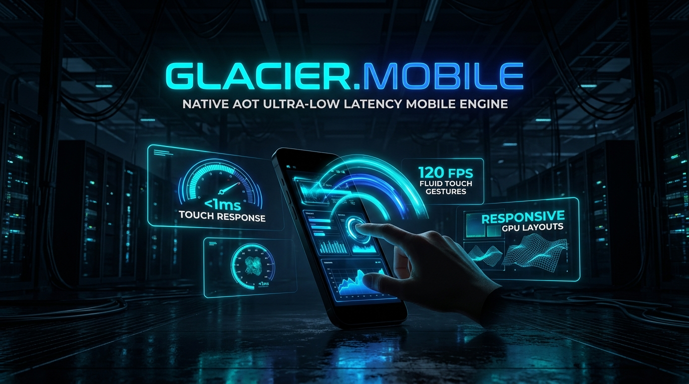
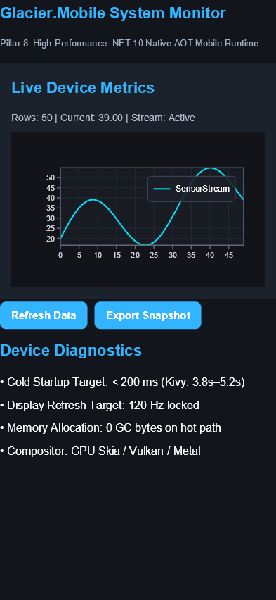

# 📱 Glacier.Mobile

[](LICENSE)
[](https://dotnet.microsoft.com/)
[](https://learn.microsoft.com/dotnet/core/deploying/native-aot/)
[](https://www.nuget.org/packages/Glacier.Mobile/)
[](https://github.com/ian-cowley)
[](https://glaciersoftware.dev/)
[](https://buymeacoffee.com/glaciersoftware)

> **Native AOT Cross-Platform Mobile Engine for C# .NET 10 (Systematically Beating Python Kivy)**

`Glacier.Mobile` is a cross-platform mobile application runtime engineered natively for C# .NET 10 Native AOT. It provides sub-200ms cold startup, SkiaSharp / Metal / Vulkan composition, and a zero-allocation touch/gesture pipeline running at a 120Hz refresh rate.

---

## 1. Why Glacier.Mobile? Replacing Python Kivy

**Kivy** suffers from production shortcomings on mobile devices:

1. **Cold Start Latency**: Initializing the CPython interpreter takes **3 to 6 seconds** on typical mobile hardware before displaying the first frame.
2. **Binary Bloat**: Bundling CPython and C extensions inflates minimal APKs/IPAs to 80MB–150MB.
3. **Touch Stutter**: Python event loops struggle to sustain 120Hz ProMotion / Smooth Display scrolling without GC jank.

**Glacier.Mobile** addresses these challenges natively on .NET 10:
- **Direct Native ARM64 Machine Code**: Ahead-of-time (AOT) compilation with zero interpreter overhead.
- **120Hz Kinetic Physics & Rendering**: `MobileApplication.Step(dt)` ticks `ScrollView` SIMD inertial damping alongside hardware-accelerated SkiaSharp composition.
- **Zero-Allocation Touch Pipeline**: Stack-allocated `readonly ref struct TouchEvent` payloads and a lock-free SPSC `TouchRingBuffer`.

---

## 🖼️ Visual Gallery: Real Rendered Mobile UI Snapshot

<div align="center">

| Glacier.Mobile System Monitor (iOS / Android Layout) |
| :---: |
|  |
| *Native mobile layout with Polaris DataFrame telemetry stream, device diagnostics, and touch controls* |

</div>

---

## 2. Zero-Allocation Touch & Gesture Input Pipeline

```csharp
[StructLayout(LayoutKind.Sequential)]
public readonly ref struct TouchEvent
{
    public readonly long Timestamp;
    public readonly int PointerId;
    public readonly float X;
    public readonly float Y;
    public readonly TouchPhase Phase;
}
```
Touch events flow from OS callbacks through `TouchRingBuffer` and `PointerCaptureTable` to `TapGestureRecognizer`, `PanGestureRecognizer` (with incremental `DeltaX`/`DeltaY`), and `PinchGestureRecognizer` (with incremental `DeltaScale`).

---

## 3. Quickstart API

```csharp
using Glacier.Mobile.Core;
using Glacier.Mobile.Interop;
using Glacier.Mobile.UI;
using Glacier.Mobile.UI.Controls;
using Glacier.Mobile.UI.Layouts;
using Glacier.Mobile.UI.Navigation;
using Glacier.Polaris;
using Glacier.Polaris.Data;

public sealed class AppShell : MobileApplication
{
    protected override MobileView Build()
    {
        var telemetry = new TelemetryView("Real-Time Telemetry");
        var values = new Float32Series("Value", 32);
        for (int i = 0; i < 32; i++) values[i] = MathF.Sin(i * 0.25f) * 10f + 50f;
        telemetry.BindDataFrame(new DataFrame([values]), "Value");

        return new NavigationStack
        {
            new Screen("Dashboard")
            {
                Content = new ScrollView
                {
                    Content = new Column(spacing: 16f)
                    {
                        new Header("System Monitor"),
                        telemetry,
                        new Button("Export Snapshot", onClick: () => { })
                    }
                }
            }
        };
    }
}
```

---

## 4. Ecosystem Cross-References

- **[Glacier Ecosystem Website](https://glaciersoftware.dev/)**: Unified .NET 10 high-performance architecture overview.
- **[Glacier.Desktop](https://github.com/ian-cowley/Glacier.Desktop)**: Native desktop GUI engine and virtualized 1M-row data grids.
- **[Glacier.Plot](https://github.com/ian-cowley/Glacier.Plot)**: High-speed mobile charts integrated via `PlotView`.
- **[Glacier.Polaris](https://github.com/ian-cowley/Glacier.Polaris)**: Embedded columnar analytics powering `TelemetryView`.

---

## 🆕 What's New in v1.1.0

- **Cached `SKTypeface` & Native Handle Hygiene** — eliminated per-frame `SKTypeface.FromFamilyName` allocations in `Label` and `Button` and ensured `SKRoundRect` native handles are deterministically disposed.
- **Live 120Hz `ScrollView` Inertial Physics & Touch Bubbling** — `MobileApplication.Step(dt)` now ticks `MobileView.Update(dt)` across the active visual tree, and passive child views bubble touch gestures cleanly to parent `ScrollView` containers.
- **Incremental `DeltaX`/`DeltaY` & `DeltaScale` Gesture Tracking** — eliminated compounding quadratic pan drift and exponential pinch zoom in `PlotView`.
- **Upgraded to `Glacier.Polaris 1.1.0` and `Glacier.Plot 1.1.0`** with zero transitive NuGet vulnerabilities and NuGet OIDC Trusted Publishing CI.

---

## Credits

Developed by Ian Cowley and Antigravity (Google DeepMind).

---

## License

Licensed under the [MIT License](LICENSE). Copyright (c) 2026 Ian Cowley.

---

## ❄️ Glacier Ecosystem & Support

Part of the **[Glacier Ecosystem](https://glaciersoftware.dev/)** — high-performance, zero-allocation developer tooling and data engines natively built for modern C# and .NET 10.

* 🌐 **Website & Documentation**: [glaciersoftware.dev](https://glaciersoftware.dev/)
* ☕ **Buy Me a Coffee**: [buymeacoffee.com/glaciersoftware](https://buymeacoffee.com/glaciersoftware)
* ❤️ **GitHub Sponsors**: [github.com/sponsors/ian-cowley](https://github.com/sponsors/ian-cowley)
* 🐙 **All Repositories**: [github.com/ian-cowley](https://github.com/ian-cowley)
